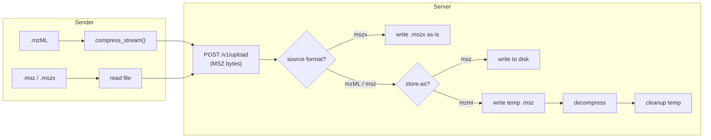

# mstransfer

[](https://github.com/chrisagrams/mstransfer/actions/workflows/test.yml)
[](https://codecov.io/gh/chrisagrams/mstransfer)

Transfer mass spectrometry files (mzML / MSZ) between machines over HTTP. Files are always transported in compressed MSZ format using [mscompress](https://github.com/chrisagrams/mscompress) — mzML sources are compressed on-the-fly without temp files, and the receiving end can optionally decompress back to mzML.

## Install

```bash
# Recommended — installs as an isolated CLI tool
uv tool install mstransfer

# Or with pipx
pipx install mstransfer

# Or as a project dependency
uv pip install mstransfer
pip install mstransfer
```

## Quick start

Start a server on the receiving machine:

```bash
mstransfer serve --port 1319 --store-as msz
```

Upload files from the source machine:

```bash
mstransfer upload /data/experiment1.mzML /data/batch/ remote-host:1319
```

## Usage

### `mstransfer serve`

Start the receiver server.

```
mstransfer serve [--host 0.0.0.0] [--port 1319] [--output-dir ./received] [--store-as msz|mzml]
```

| Flag | Default | Description |
|------|---------|-------------|
| `--host` | `0.0.0.0` | Bind address |
| `--port` | `1319` | Listen port |
| `--output-dir` | `./received` | Where received files are written |
| `--store-as` | `msz` | Store as `msz` (compressed) or `mzml` (decompress on arrival). `.mszx` archives are always stored as-is. |

### `mstransfer upload`

Upload files to a server. Accepts any mix of files and directories. The last positional argument is the target.

```
mstransfer upload <paths...> <host[:port]> [--recursive] [--parallel 4]
```

| Flag | Default | Description |
|------|---------|-------------|
| `--recursive`, `-r` | off | Recurse into directories |
| `--parallel`, `-p` | `4` | Number of concurrent uploads |

Supported file types: `.mzML`, `.msz`, `.mszx`.

- **mzML files** are compressed to MSZ on-the-fly via `compress_stream()` and streamed directly into the HTTP request — no temp files on the sender.
- **MSZ / MSZX files** are streamed as-is.

The client sends the format in an `X-Source-Format` header (`mzML`, `msz` or `mszx`). The server stores `.mszx` uploads untouched as `<stem>.mszx`, whatever `--store-as` says.

The server names each stored file after the upload's stem, so `run1.mzML` and `run1.msz` both become `run1.msz`. It refuses an upload with **409 Conflict** if that output file already exists or another transfer is still writing it. The refused file counts as failed, and the CLI exits non-zero.

### `mstransfer download`

Download files by URL, e.g. `http://remote-host:1319/v1/files/run1.msz` (see `GET /v1/files` for what a server offers).

```
mstransfer download <urls...> [--output-dir ./downloads] [--parallel 4] [--store-as msz|mzml|mszx] [--skip-existing] [--force] [--no-resume]
```

| Flag | Default | Description |
|------|---------|-------------|
| `--output-dir`, `-o` | `./downloads` | Where downloaded files are written |
| `--parallel`, `-p` | `4` | Number of concurrent downloads |
| `--store-as` | as-is | Convert each download to `msz`, `mzml` or (for `.mszx` only) `mszx` |
| `--skip-existing` | off | Skip files whose output already exists |
| `--force` | off | Download again even if the output exists, discarding any partial download |
| `--no-resume` | off | Start interrupted downloads over instead of resuming them |

Each file is streamed to `<name>.part` and moved into place only once it is complete. If a download is interrupted (an error, a dropped connection, or Ctrl-C), the partial file stays next to the output with a `<name>.part.json` describing it, and the next download of the same URL to the same place continues from where it stopped. It sends a `Range` request with `If-Range`, so it only resumes if the server supports byte ranges and the file is unchanged (same `ETag` or `Last-Modified`); otherwise the download starts over. A partial is only kept when the server sent such a validator and the file size. The finished file must be exactly the size the server announced.

The mstransfer server supports range requests and sends `ETag`/`Last-Modified`, so downloads from it can be resumed.

### Authentication

`serve`, `upload` and `download` all take `--api-key`. On `serve` it makes the server require that key; on `upload` and `download` it is sent as `Authorization: Bearer <key>`. When `--api-key` is not given, each command reads the `MS_API_KEY` environment variable instead. If neither is set (or `MS_API_KEY` is empty), no key is used.

```
export MS_API_KEY=secret
mstransfer serve                                        # requires the key
mstransfer upload run1.mzML remote-host                 # sends the key
mstransfer download http://remote-host:1319/v1/files/run1.msz
```

## Programmatic access

You can use mstransfer as a library to send files from your own Python code:

```python
from pathlib import Path
from mstransfer.client import send_file, send_batch

# Send a single file (Path)
result = send_file(Path("experiment.mzML"), "http://remote-host:1319")

# Send an already-opened mscompress object
from mscompress import MZMLFile, MSZFile
from mscompress.mszx import MSZXFile

mzml = MZMLFile(b"/data/experiment.mzML")
send_file(mzml, "http://remote-host:1319")

msz = MSZFile(b"/data/experiment.msz")
send_file(msz, "http://remote-host:1319")

mszx = MSZXFile.open("/data/experiment.mszx")
send_file(mszx, "http://remote-host:1319")

# Send multiple files in parallel
send_batch(
    [Path("a.mzML"), Path("b.msz"), mszx],
    "http://remote-host:1319",
    parallel=4,
)
```

`send_file` and `send_batch` accept any mix of `Path`, `MZMLFile`, `MSZFile`, and `MSZXFile` inputs.

## API

The server exposes a REST API under `/v1/`:

| Endpoint | Method | Description |
|----------|--------|-------------|
| `/v1/health` | GET | Server status, version, storage mode |
| `/v1/upload` | POST | Upload a file (streamed MSZ body) |
| `/v1/transfer/{id}/status` | GET | Poll transfer state |

### Embedding in another app

The server is built as a FastAPI app factory:

```python
from mstransfer import create_app

# Standalone
app = create_app(output_dir="/data/ms", store_as="mzml")

# Mount in an existing FastAPI app
from fastapi import FastAPI

main_app = FastAPI()
main_app.mount("/transfer", create_app())
```

## How it works



## Development

```bash
uv sync --dev
uv run pytest
uv run ruff check src/ tests/
```

### Pre-commit hooks

Install the pre-commit hooks to automatically run linting, type checking, and tests before each commit:

```bash
uv run pre-commit install
```
