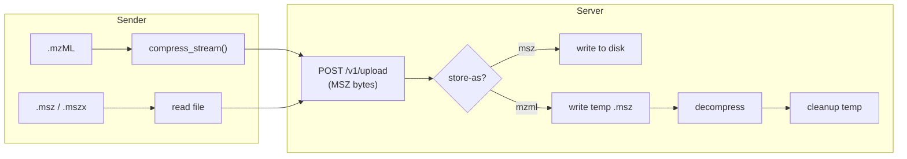

# mstransfer

[](https://github.com/chrisagrams/mstransfer/actions/workflows/test.yml)
[](https://codecov.io/gh/chrisagrams/mstransfer)

Transfer mass spectrometry files (mzML / MSZ) between machines over HTTP. Files are always transported in compressed MSZ format using [mscompress](https://github.com/chrisagrams/mscompress) — mzML sources are compressed on-the-fly without temp files, and the receiving end can optionally decompress back to mzML.

## Install

```bash
# Recommended — installs as an isolated CLI tool
uv tool install mstransfer

# Or with pipx
pipx install mstransfer

# Or as a project dependency
uv pip install mstransfer
pip install mstransfer
```

## Quick start

Start a server on the receiving machine:

```bash
mstransfer serve --port 1319 --store-as msz
```

Upload files from the source machine:

```bash
mstransfer upload /data/experiment1.mzML /data/batch/ remote-host:1319
```

## Usage

### `mstransfer serve`

Start the receiver server.

```
mstransfer serve [--host 0.0.0.0] [--port 1319] [--output-dir ./received] [--store-as msz|mzml]
```

| Flag | Default | Description |
|------|---------|-------------|
| `--host` | `0.0.0.0` | Bind address |
| `--port` | `1319` | Listen port |
| `--output-dir` | `./received` | Where received files are written |
| `--store-as` | `msz` | Store as `msz` (compressed) or `mzml` (decompress on arrival) |

### `mstransfer upload`

Upload files to a server. Accepts any mix of files and directories. The last positional argument is the target.

```
mstransfer upload <paths...> <host[:port]> [--recursive] [--parallel 4] [--connections 1]
```

| Flag | Default | Description |
|------|---------|-------------|
| `--recursive`, `-r` | off | Recurse into directories |
| `--parallel`, `-p` | `4` | Number of files uploaded concurrently |
| `--connections`, `-c` | `1` | Concurrent connections per MSZ/MSZX file (multipart upload) |
| `--chunk-size` | `1048576` | Read/stream chunk size in bytes |

Supported file types: `.mzML`, `.msz`, `.mszx`.

- **mzML files** are compressed to MSZ on-the-fly via `compress_stream()` and streamed directly into the HTTP request — no temp files on the sender.
- **MSZ / MSZX files** are streamed as-is. With `--connections N` (N > 1), files of at least 16 MiB are split into up to N byte-range parts (each at least 8 MiB) that are uploaded concurrently over separate connections. This can improve throughput on high-latency or per-connection rate-limited links. `--connections` is independent of `--parallel`, so up to `parallel × connections` requests may be in flight.

## Programmatic access

You can use mstransfer as a library to send files from your own Python code:

```python
from pathlib import Path
from mstransfer.client import send_file, send_batch

# Send a single file (Path)
result = send_file(Path("experiment.mzML"), "http://remote-host:1319")

# Send an already-opened mscompress object
from mscompress import MZMLFile, MSZFile
from mscompress.mszx import MSZXFile

mzml = MZMLFile(b"/data/experiment.mzML")
send_file(mzml, "http://remote-host:1319")

msz = MSZFile(b"/data/experiment.msz")
send_file(msz, "http://remote-host:1319")

mszx = MSZXFile.open("/data/experiment.mszx")
send_file(mszx, "http://remote-host:1319")

# Send multiple files in parallel
send_batch(
    [Path("a.mzML"), Path("b.msz"), mszx],
    "http://remote-host:1319",
    parallel=4,
)

# Split a large MSZ file across 8 concurrent connections
send_file(Path("big.msz"), "http://remote-host:1319", connections=8)
```

`send_file` and `send_batch` accept any mix of `Path`, `MZMLFile`, `MSZFile`, and `MSZXFile` inputs.

## API

The server exposes a REST API under `/v1/`:

| Endpoint | Method | Description |
|----------|--------|-------------|
| `/v1/health` | GET | Server status, version, storage mode |
| `/v1/upload` | POST | Upload a file (streamed MSZ body) |
| `/v1/uploads` | POST | Initiate a multipart upload |
| `/v1/uploads/{id}/parts/{n}` | PUT | Upload part `n` of a multipart upload |
| `/v1/uploads/{id}/complete` | POST | Verify all parts and finalize the file |
| `/v1/uploads/{id}` | DELETE | Abort a multipart upload |
| `/v1/transfer/{id}/status` | GET | Poll transfer state |

### Multipart uploads

Files whose size is known up front (MSZ / MSZX) can be uploaded in parts over several concurrent connections:

1. `POST /v1/uploads` with JSON `{"transfer_id", "filename", "total_size", "part_size"}`. The server preallocates the output file and returns `part_count`. Part `n` covers bytes `[n * part_size, min((n + 1) * part_size, total_size))`.
2. `PUT /v1/uploads/{id}/parts/{n}` with exactly that byte range as the body. Parts may arrive concurrently and in any order, and each one is written in place at its offset. Re-sending a part overwrites it, so a failed part can be retried. A body of the wrong size is rejected with `400`, and two concurrent requests for the same part are rejected with `409`.
3. `POST /v1/uploads/{id}/complete` returns `409` until every part has been fully received. After that, the file goes through the same store/decompress path as `/v1/upload`.

`DELETE /v1/uploads/{id}` aborts the upload: the transfer moves to `error` and the partial file is removed. While a multipart upload is in progress, `/v1/transfer/{id}/status` reports `total_bytes` and per-part progress in `parts`.

### Embedding in another app

The server is built as a FastAPI app factory:

```python
from mstransfer import create_app

# Standalone
app = create_app(output_dir="/data/ms", store_as="mzml")

# Mount in an existing FastAPI app
from fastapi import FastAPI

main_app = FastAPI()
main_app.mount("/transfer", create_app())
```

## How it works



## Development

```bash
uv sync --dev
uv run pytest
uv run ruff check src/ tests/
```

### Pre-commit hooks

Install the pre-commit hooks to automatically run linting, type checking, and tests before each commit:

```bash
uv run pre-commit install
```
