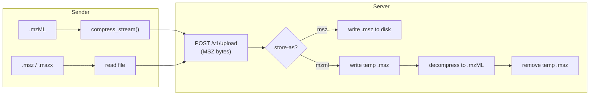

# mstransfer

Transfer mass spectrometry files (mzML / MSZ / MSZX) between machines over
HTTP. Files always travel in compressed MSZ format using
[mscompress](https://chrisagrams.github.io/mscompress/): mzML sources are
compressed on the fly while they upload, with no temp files on the sender,
and the receiver can store them as MSZ or decompress them back to mzML.

```bash
# On the receiving machine
mstransfer serve --port 1319 --store-as msz

# On the sending machine
mstransfer upload /data/experiment1.mzML /data/batch/ remote-host:1319
```

## What's included

- **CLI**: `mstransfer serve`, `upload`, and `download`, with parallel
  transfers and Rich progress bars. See [CLI](cli/index.md).
- **Python client**: `send_file` / `send_batch` and `download_file` /
  `download_batch`, each with an `async_` variant. See
  [Python guides](guides/index.md).
- **Embeddable server**: a FastAPI app factory and router with pluggable
  authentication and file discovery. See [Server](server/index.md).

## How it works



## Where to go next

- [Installation](getting-started/installation.md)
- [Quick Start](getting-started/quickstart.md)
- [CLI reference](cli/index.md)
- [HTTP API](server/http-api.md)
- [API Reference](reference/index.md)
- [Contributing](contributing/index.md)

## For LLMs and coding agents

These docs are also published as Markdown, which models read far more
reliably than HTML:

- [`llms.txt`](https://chrisagrams.github.io/mstransfer/llms.txt) — index of
  every page, following the [llms.txt](https://llmstxt.org/) convention
- [`llms-full.txt`](https://chrisagrams.github.io/mstransfer/llms-full.txt) —
  the entire site concatenated into one file
- Per-page Markdown — append `index.md` to any page URL, e.g.
  [`getting-started/installation/index.md`](https://chrisagrams.github.io/mstransfer/getting-started/installation/index.md)
