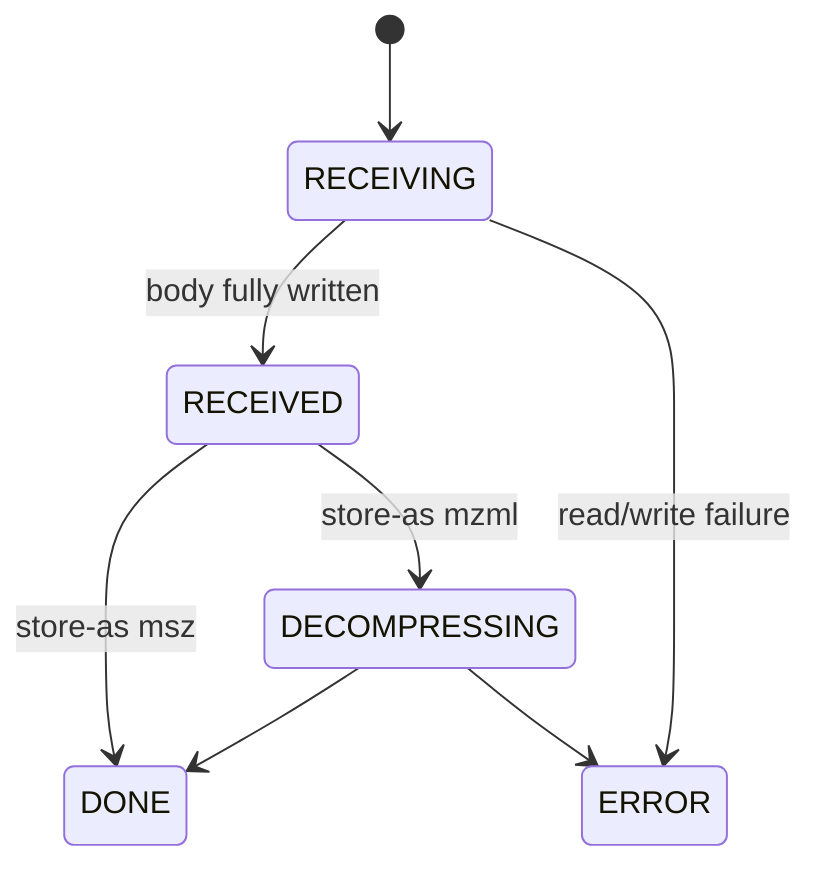

# Server

The mstransfer server is a FastAPI application. Run it with
[`mstransfer serve`](../cli/index.md#mstransfer-serve), or build it in Python
and serve it however you like.

- [HTTP API](http-api.md): endpoints, headers, and transfer states
- [Embedding in FastAPI](embedding.md): `create_app` and `make_router`
- [Authentication](auth.md): API keys and custom auth providers
- [File providers](file-providers.md): control what `/v1/files` lists and serves
- [Deployment](deployment.md): Docker and running behind a reverse proxy

## Transfer lifecycle

Each upload is tracked in an in-memory registry under the `X-Transfer-ID`
the client sends:

The registry keeps up to 1024 records. Past that, the least recently used
finished (`DONE` or `ERROR`) record is evicted; in-progress transfers are never
evicted. Records do not survive a restart.
